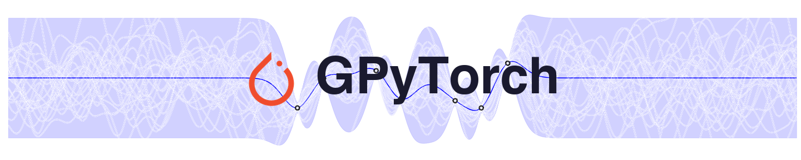

# Gaussian Processes for Time Series with PyTorch

[](https://colab.research.google.com/drive/1_uG0memqk_Idj51RvfZ-KtlwQMstgF1X)



A hands-on tutorial on fitting Gaussian processes to time series with [GPyTorch](https://gpytorch.ai), prepared for CSC6022. The main lesson is that **the kernel is the model**, so most of the work goes into designing the right kernel for the data.

## What is inside

1. A short recap of Gaussian processes
2. The GPyTorch building blocks (model, kernels, training loop)
3. A worked example on the Mauna Loa CO₂ dataset
4. An exercise where you design a kernel for real wireless traffic data from Huawei
5. A pointer to automated kernel design with LLMs ([CAKE](https://github.com/richardcsuwandi/cake) and [Kernaut](https://github.com/richardcsuwandi/kernaut))

## How to run

**On Google Colab (recommended).** Click the badge above and choose *Runtime → Run all*. Nothing needs to be installed or uploaded.

**On your own machine.** Clone the repository, install the packages, and open the notebook.

```bash
git clone https://github.com/richardcsuwandi/gp-time-series-tutorial.git
cd gp-time-series-tutorial
pip install torch gpytorch scikit-learn pandas matplotlib jupyter
jupyter notebook gp_time_series_tutorial.ipynb
```

## Data

* **Mauna Loa CO₂.** Downloaded automatically from OpenML inside the notebook.
* **Huawei wireless traffic** ([`huawei_cell_traffic.csv`](huawei_cell_traffic.csv)). Uplink traffic of 30 anonymized wireless network cells, recorded every 5 minutes for 7 days (2024-11-30 to 2024-12-07). The notebook loads it straight from this repository.
